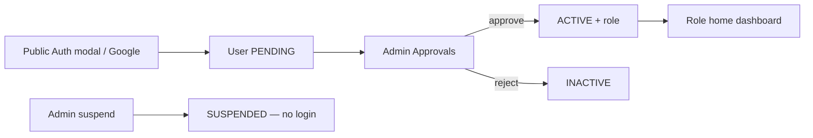

# Alubonets SHG

Public website and member platform for **Alubonets Self-Help Group**.

**Prepared by:** SpectreTech Limited  
**Aligned with:** Solution Design Document (v0) — July 2026  
**Stack:** Next.js 15 · TypeScript · Tailwind · Prisma · Supabase Auth  

**Dev URL:** [http://localhost:3001](http://localhost:3001)

| Doc | Purpose |
|-----|---------|
| **This README** | Product overview, how it works, **current platform status** |
| [docs/OPERATIONS.md](docs/OPERATIONS.md) | Setup, environments, deploy, backups, monitoring |
| [docs/ARCHITECTURE.md](docs/ARCHITECTURE.md) | Data model, design system, decisions, security |
| [docs/IMPLEMENTATION.md](docs/IMPLEMENTATION.md) | **Website Upgrade Guide** plan — feature scores & phases |
| [docs/ACCEPTANCE.md](docs/ACCEPTANCE.md) | Testing, sign-off, role guides |

---

## Quick start

```bash
npm install
copy .env.local.example .env.local   # fill secrets — see docs/OPERATIONS.md
npm run db:push
npm run db:seed
npm run db:bootstrap-auth
npm run dev
```

Full setup: **[docs/OPERATIONS.md](docs/OPERATIONS.md)**.  
Super Admin (real email): **[docs/ARCHITECTURE.md](docs/ARCHITECTURE.md#authentication-production)**.

---

## What is built (platform status)

Baseline from the Stage 0–9 member portal (July 2026). The next upgrade (Principal/family hierarchy, directory, Today’s Activities, payment purposes/account settings) is tracked in **[docs/IMPLEMENTATION.md](docs/IMPLEMENTATION.md)** (~55% vs Upgrade Guide; family hierarchy ~18%).

### Stack / wiring

| Layer | Status |
|-------|--------|
| Next.js 15 + Tailwind + TypeScript | Done — public site + role dashboards |
| Supabase Auth (`@supabase/ssr`) | Done — login, register, Google, middleware |
| Prisma → Supabase Postgres | Done — dashboards live |
| Roles: Admin, Executive, Treasurer, Secretary, Organizer, Member | Done |
| Register → Admin approve → portal | Done |
| Profile / own contributions / statements | Done |
| Ledger, reconciliation, M-Pesa STK path | Done |
| Documents + versions + governance meetings | Done |
| Events RSVP, announcements (email + dashboard) | Done |
| Projects, welfare, gallery approval | Done |
| Optional loans (`loans_enabled`) | Done |
| Audit logs | Done |
| Vitest + Playwright smoke + CI | Done |

### Acceptance (original brief)

| Criterion | Status |
|-----------|--------|
| Public pages + contact form | Met |
| No portal until Admin approve | Met |
| Admin approve + assign roles | Met |
| Member own contributions only | Met |
| Treasurer finance / reconcile / reports | Met (some reports thin) |
| Secretary Word/PDF minutes | Met |
| Organizer events | Met |
| Executive dashboards | Met |
| Audit trail | Met |
| Mobile usable | Met (formal a11y CI deferred) |
| Backup restore drill recorded | Partial |

### Not in baseline (Upgrade Guide gaps)

| Gap | Notes |
|-----|--------|
| Principal Member / family branch model | Core of next upgrade |
| Member directory + attached-profile visibility | Hidden-by-default privacy |
| Today’s Activities feed | Member-only |
| Official bank account setting + 20/80 fund rule | Configurable settings |
| Child/dependent records without login | Record-only members |
| Auditor role | Optional |

Full expected / implemented / remaining tables for the upgrade live in **[docs/IMPLEMENTATION.md](docs/IMPLEMENTATION.md)**.

---

## Project map

```
app/
  (public)/          # Home, about, projects, gallery, contact
  admin/             # Admin overview + members, approvals, roles, gallery-queue
  dashboard/         # executive | treasurer | secretary | organizer | member
  profile/           # Shared profile page (all signed-in users)
  auth/callback/     # Google OAuth code exchange
  api/               # auth, pdf, mpesa, export, …
components/          # layout, auth, dashboard shell, profile
lib/                 # prisma, auth, email, data queries, mpesa
prisma/              # schema + seed
supabase/            # policies.sql, storage.sql
docs/                # OPERATIONS, ARCHITECTURE, IMPLEMENTATION, ACCEPTANCE (+ Formal/)
```

---

## How authentication works



1. **Register** only on the public Auth modal (or Google). Creates Supabase Auth user + Prisma `users` row with `status = PENDING`, `role = MEMBER`.
2. **Admin** opens `/admin/approvals` → approve (`ACTIVE`) or reject (`INACTIVE`). Metadata syncs to JWT.
3. **Login** (`/login` or `/admin/login`) uses `signInWithPassword`. Staff admin login has **no** Google button and **no** register.
4. Middleware reads JWT `app_metadata`: `{ role, status, isSuperAdmin, dashboardAccess }` — no Prisma on the Edge.
5. **PENDING** → `/pending` (can still open `/profile`). **SUSPENDED** → signed out with: *“Your account has been temporarily suspended. Please contact the group administrator.”*
6. **Google:** Auth modal → Supabase OAuth → `/auth/callback` upserts Prisma user and redirects to `/pending` or role home.

### Roles and access

| Actor | Approve members | Set EXEC…MEMBER | Set ADMIN | Super Admin flag | Suspend Admins |
|-------|-----------------|-----------------|-----------|------------------|----------------|
| Super Admin | Yes | Yes | Yes | Yes (keep ≥1) | Yes |
| Admin | Yes | Yes | No | No | Non-admins only |
| Others | No | No | No | No | No |

- **Primary `role`** → home path (`ROLE_HOME`): `/admin`, `/dashboard/executive`, … `/dashboard/member`.
- **`dashboardAccess`** → optional extra workspaces; **Workspace** switcher in the dashboard header.
- **Super Admin** always sees every dashboard.
- Shared **profile:** `/profile` for every signed-in user (members and management).

---

## How contributions and payments work

### Manual / CSV (treasurer)

1. Treasurer records a contribution (member, amount, method, optional M-Pesa ref) or uploads CSV (`email, amount, …`).
2. Prisma creates a `contributions` row.
3. Optional Resend receipt email when configured.
4. Member or treasurer downloads **PDF receipt:** `/api/pdf/receipt/[contributionId]`.
5. Member **statement PDF:** `/api/pdf/statement/[userId]` (own history).

### M-Pesa STK Push

1. Treasurer (or allowed role) submits phone + amount via STK form → `POST /api/mpesa/stk`.
2. Daraja sends prompt to the phone; checkout request id is stored for matching (audit / meta).
3. Safaricom calls `POST /api/mpesa/callback` on success/failure.
4. On success the app creates/links a `Contribution` (amount, `mpesaRef`, method `MPESA`).
5. Receipt PDF uses the same contribution row as cash/bank payments.

Without Daraja env vars, STK stays inactive; the rest of finance still works.

---

## How PDFs and Word exports work

| Output | Route / entry | Built with |
|--------|---------------|------------|
| Contribution receipt | `/api/pdf/receipt/[id]` | pdf-lib — group header, member, amount, date, refs |
| Member statement | `/api/pdf/statement/[userId]` | pdf-lib — contribution list for that member |
| Meeting pack | `/api/export/meetings` | docx — title, date, attendance, agenda, minutes |
| Meeting minutes PDF | `/api/pdf/minutes/[id]` | pdf-lib — letterhead from DB text; publish stores copy in `documents` bucket |

Auth checks ensure members only get their own receipts/statements unless staff.

---

## How dashboards work

Each role has an overview plus section pages (nav in `lib/dashboard/nav.ts`):

| Area | Examples |
|------|----------|
| Admin | KPIs, members directory, approvals, roles & dashboard access, gallery queue, suspend/restore |
| Executive | Projects, announcements, contribution charts |
| Treasurer | Contributions, welfare reviews, CSV, M-Pesa STK |
| Secretary | Announcements, meetings, documents |
| Organizer | Events, gallery, projects |
| Member | Own contributions, welfare requests, live announcements |

Charts are server-aggregated (Prisma) and rendered with Chart.js. Announcements on the member home can update via Supabase Realtime when enabled.

---

## How email works

`lib/email/resend.ts` sends when `RESEND_API_KEY` + `FROM_EMAIL` are set. Typical triggers: membership approved, contribution/welfare notices. Sends are logged in `email_logs` when the app records them. Missing keys → no-op (no crash).

---

## How gallery and storage work

1. Organizer/member adds photo metadata (URL today; Storage bucket `gallery` for uploads when wired).
2. Unpublished photos sit in the admin **gallery queue** (`isPublic = false`).
3. Admin publishes → `isPublic = true` → public gallery.
4. Bucket `documents` is private (secretary/admin upload; members via signed URLs / app links).

SQL for buckets: `supabase/storage.sql`.

---

## Scripts

| Command | Description |
|---------|-------------|
| `npm run dev` | Dev server → **:3001** |
| `npm run build` / `start` | Production |
| `npm run lint` | ESLint |
| `npm run db:generate` | Prisma client |
| `npm run db:push` | Sync schema to Supabase |
| `npm run db:migrate` | Versioned migrations |
| `npm run db:seed` | Seed Prisma data |
| `npm run db:bootstrap-auth` | Create/link Super Admin Supabase Auth user |
| `npm run db:test` | Connection smoke test |
| `npm run db:studio` | Prisma Studio |

---

## September 2026 meeting changes (planned)

Agreed in the review meeting on September 9, 2026. Status: **planned, not yet implemented**.

### Agreed decisions

1. **Paid-up standing.** A member's login status stays as it is today. The system will also keep a separate, automatic "paid-up standing" (Paid-up or Lapsed) for each member. A lapsed member can still log in and see past events and the gallery, but cannot see upcoming events, projects or other member-only features.
2. **Monthly fee rule.** Each month's fee is due by the end of that month. If it is still unpaid when the grace period in the following month ends, the member becomes lapsed. The grace period defaults to **15 days**.
3. **Annual subscription rule.** If the annual subscription is not renewed within the renewal window after it expires, the member becomes lapsed. The renewal window defaults to **45 days**.
4. **Admin-editable standing settings.** In Admin Finance, a new "Membership standing" panel lets the Admin set and change:
   - the monthly fee amount (KES)
   - the monthly grace period in days (default 15)
   - the annual subscription amount (KES)
   - the annual renewal window in days (default 45)
   - whether automatic standing is switched on or off
5. **Automatic reactivation.** When a payment is confirmed and the member has paid the full required amount (the full monthly fee for the month, or the full annual subscription), the system marks them paid-up again immediately. Partial payments do not reactivate a member.
6. **Manual Admin control.** The Admin can mark any member paid-up or lapsed by hand, with an optional end date, for example to give a member a deadline extension. After that date, the automatic rules apply again.
7. **Organizing Secretary.** The existing "Organizer" role will be renamed to "Organizing Secretary". No new role will be created.
8. **Lineage.** Lineage will be removed from the Family & Branch page, the registration form and the profile form. Old lineage data will remain only in the admin export.

### Already done (to be checked only)

9. The Treasurer can already record backdated (historical) payments.
10. Members can already download their personal PDF statements.
11. Governance already follows this flow: the Secretary or Admin creates a document, the Admin approves it, and then it is published. The Admin can turn anonymous comments on or off for each document.
12. Meeting minutes can already be exported as PDF and Word.
13. The read-only document library for registered members already exists.
14. Admins, the Secretary and the Organizer can already create events, and members are notified when an event is created.
15. Admins can already set an expense limit (for example, KES 50,000) above which approval is required.

### Phase 1: Membership standing and page access

16. The system will check every member's payments automatically and mark them paid-up or lapsed using the deadlines and amounts set by the Admin.
17. A member will receive a notification when they become lapsed, and another when they become paid-up again.
18. The Admin Members table will show each member's standing and the reason, for example "March fee unpaid".
19. Upcoming events will be visible only to paid-up members.
20. All projects will be private and visible only to paid-up members.
21. Past events and the gallery will be visible to all registered members who are logged in.
22. Visitors who are not logged in will be asked to log in. Lapsed members will see a "Renew your membership" message.

### Phase 2: Treasurer finance tools

23. The payment form will have a required "Purpose" dropdown, for example Monthly Contribution, Annual Subscription, Funeral or a specific project.
24. The Treasurer, and not only the Admin, will be able to add and edit payment purpose categories.
25. The default purposes (Monthly Contribution, Annual Subscription, Funeral and Registration) will be set up automatically.
26. Active contribution campaigns will appear in the purpose dropdown.
27. Admins and the Treasurer will be able to create contribution campaigns with an overall target amount and an optional target per member.
28. Campaigns can be edited or deactivated, and campaigns with past start dates will be allowed.
29. A campaign progress page will show how much each member has paid against their target, with an option to waive a member's obligation.
30. New members who join after a campaign starts will automatically receive their campaign obligation.
31. The Treasurer's Contributions History page will have a member dropdown filter, a purpose filter and a Purpose column.
32. Monthly payments will record which month they cover.
33. A new "Active Months" report will show how many paid-up months each member has. This will be the basis for calculating dividends.
34. The approval limit will apply only to expenses and disbursements, not to incoming contributions, and only to amounts above the limit.
35. The default payment date will use Kenya time so it does not show the previous day.

### Phase 3: Projects

36. Projects will have a start date and an end date.
37. A project's status will be set automatically from its dates: Upcoming before the start date, Ongoing between the dates, and Completed after the end date.
38. The project progress bar will show money raised against the target amount, not member engagement.
39. Payments made for a project will count towards that project's target.
40. Expenses can be linked to a project so that spending on each project can be tracked.

### Phase 4: Roles, Principal Members and lineage

41. "Organizer" will be renamed "Organizing Secretary" everywhere in the system.
42. The Secretary will get a link to create and manage events.
43. Only the Super Admin will be able to add, change or remove Admins.
44. A "Make Principal" button will be added to the Admin Roles page.
45. Principal Members will be able to transfer their attached members to another Principal Member. Every transfer will be recorded in the audit history.
46. Lineage will be removed from the Family & Branch page, registration, the profile page and the directory, and it will become an optional field.
47. Auditors are currently stuck on a page that keeps redirecting them. This will be fixed.
48. Auditors will have read-only access to financial reports, exports, member statements, documents, governance and member details.
49. Only Admins and the Secretary will be able to manage document uploads. The Organizer will no longer have this permission.

### Phase 5: Public pages, Contact Us and Secretary

50. The About Us page will show executive committee profiles, each with a title, responsibilities and a profile picture.
51. Admins will choose which members appear as executive profiles on the About Us page.
52. Members will control which of their profile fields are shown publicly.
53. The Contact Us form will send each inquiry to several recipients, for example the Secretary, the Treasurer and the Chairman. Admins can edit the list in Settings.
54. Meeting attendance lists will be chosen from the member database instead of being typed in, which prevents spelling mistakes.
55. Attendance will be recorded as Present, Apology or Absent, and the total will be counted automatically.
56. Executive members will be added to the support chat responder list and will receive chat alerts.
57. When the Welfare or Loans module is turned off, users will see a "Page is disabled" message instead of a "404" error.

### Phase 6: M-Pesa and go-live

58. M-Pesa till number (Buy Goods) payments will be supported once the till details are received.
59. M-Pesa payments will include the purpose and campaign.
60. Online M-Pesa payment for members will stay hidden until the till number is ready.
61. The platform will go live on the new domain.
62. Emails will be sent from the verified domain address, and the test-email redirect will be removed.
63. The test login accounts dropdown will be turned off on the live site.

### Action items for Collins

64. Pay the remaining balance.
65. Send Kelvin the contact emails and phone numbers for the Contact Us form.
66. Send group images for the homepage and projects pages.
67. Share access to the info@ Gmail inbox.
68. Coordinate with the Chairman to apply for the M-Pesa till number and share the details with Kelvin.
69. Send Kelvin the list of required financial reports.

### Action items for both

70. Schedule a follow-up meeting to review the changes on the live domain.
71. Schedule and run training for members and admins on the new platform.

### Current blocker

72. The Supabase database project is currently paused or unreachable. It must be restored in the Supabase dashboard before the database changes can be applied.

---

## Decisions still with the group

1. Official domain / production host owner.  
2. Official Alubonets bank / paybill details (Admin finance setting).  
3. Attached-adult payment policy (own statement vs Principal-only).  
4. Dependent age for independent login.  
5. Whether 20% emergency / 80% reserve is automated.  
6. Auditor role and final office-bearer matrix.  
7. SMS/WhatsApp now or later.  

Open questions also listed in **[docs/IMPLEMENTATION.md](docs/IMPLEMENTATION.md#0-open-questions-confirm-before--during-coding)**.
