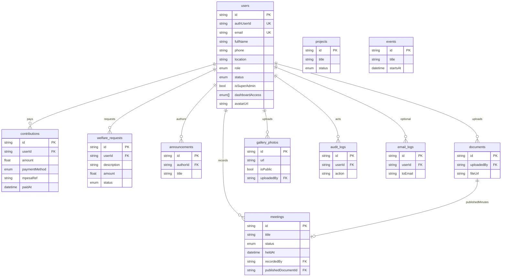

# Alubonets - Architecture

Data model, UI design system, product decisions, and security status.

| Section | Contents |
|---------|----------|
| [1. Data model](#1-data-model) | Tables, ERD, seed accounts |
| [2. Design system](#2-design-system) | Tokens, brand, components |
| [3. Decisions](#3-decisions) | Confirmed / open committee decisions |
| [4. Security status](#4-security-status) | Controls and outstanding items |

Related: [OPERATIONS.md](./OPERATIONS.md) | [IMPLEMENTATION.md](./IMPLEMENTATION.md) | [ACCEPTANCE.md](./ACCEPTANCE.md)

---

# 1. Data model
What the group’s app stores in Postgres: tables, columns, relationships, and how Auth links in.

**Source of truth:** [`prisma/schema.prisma`](../prisma/schema.prisma)  
**Postgres (Supabase)** · table names use `@@map` (e.g. `users`, `contributions`).  
**ORM:** Prisma · **Auth identities:** Supabase Auth (`auth.users`) linked via `users.authUserId`.

App writes mostly go through Prisma (service connection; bypasses RLS). Browser Supabase clients are RLS-scoped — see [`supabase/policies.sql`](../supabase/policies.sql).

**How features use this data** (receipts, payments, dashboards): root [README](../README.md).  
**How to connect and seed:** [OPERATIONS.md](./OPERATIONS.md).

---

## ERD (entity relationships)

---

## Enums

| Enum | Values | Used by |
|------|--------|---------|
| `Role` | `ADMIN`, `EXECUTIVE`, `TREASURER`, `SECRETARY`, `ORGANIZER`, `MEMBER` | `users.role`, `users.dashboardAccess[]` |
| `MemberStatus` | `PENDING`, `ACTIVE`, `INACTIVE`, `SUSPENDED` | `users.status` |
| `ProjectStatus` | `UPCOMING`, `ONGOING`, `COMPLETED` | `projects.status` |
| `WelfareStatus` | `PENDING`, `APPROVED`, `REJECTED`, `PAID` | `welfare_requests.status` |
| `PaymentMethod` | `CASH`, `MPESA`, `BANK`, `OTHER` | `contributions.paymentMethod` |
| `MeetingStatus` | `DRAFT`, `FINAL` | `meetings.status` |

---

## Tables

### `users` (model `User`)

Member and staff profiles. One row per person. Linked to Supabase Auth when `authUserId` is set.

| Column | Type | Notes |
|--------|------|--------|
| `id` | String (cuid) | Primary key (app id, not Auth uuid) |
| `authUserId` | String? unique | Supabase `auth.users.id` |
| `email` | String unique | Login / contact |
| `fullName` | String | Display name |
| `phone` | String? | Optional |
| `location` | String? | Profile location (e.g. Nairobi, Kenya) |
| `role` | Role | **Primary** home dashboard |
| `status` | MemberStatus | Gate for login / middleware |
| `isSuperAdmin` | Boolean | Hierarchy; only supers grant Admin / supers |
| `dashboardAccess` | Role[] | Extra workspaces beyond primary role |
| `avatarUrl` | String? | Profile image URL |
| `createdAt` / `updatedAt` | DateTime | |

**Relations:** owns contributions, welfare requests, audit/email logs; authors announcements; uploads documents & gallery; records meetings.

**JWT sync:** On role/status/access changes, `app_metadata` is updated to `{ role, status, isSuperAdmin, dashboardAccess }` for Edge middleware.

---

### `contributions` (model `Contribution`)

Money received from a member (cash, bank, M-Pesa, etc.).

| Column | Type | Notes |
|--------|------|--------|
| `id` | String | PK |
| `userId` | String FK → users | Cascade delete |
| `amount` | Float | Must be &gt; 0 (DB check in policies.sql) |
| `description` | String? | |
| `category` | String? | e.g. monthly dues |
| `paymentMethod` | PaymentMethod | Default `CASH` |
| `receivedBy` | String? | Who recorded it |
| `statementRef` | String? | Bank / statement ref |
| `paidAt` | DateTime | Payment date |
| `mpesaRef` | String? | M-Pesa receipt / checkout ref |
| `createdAt` | DateTime | Row created |

**Indexes:** `userId`, `paidAt`.

**Flows:** Treasurer form / CSV import / M-Pesa callback → row → PDF receipt `/api/pdf/receipt/[id]`.

---

### `welfare_requests` (model `WelfareRequest`)

Member asks for welfare support; treasurer reviews.

| Column | Type | Notes |
|--------|------|--------|
| `id` | String | PK |
| `userId` | String FK → users | Cascade |
| `description` | String | Need |
| `amount` | Float? | Optional ask |
| `status` | WelfareStatus | Default `PENDING` |
| `reviewNote` | String? | Staff note |
| `createdAt` / `updatedAt` | DateTime | |

---

### `projects` (model `Project`)

Group projects shown on public + executive/organizer/member dashboards.

| Column | Type | Notes |
|--------|------|--------|
| `id` | String | PK |
| `title` / `description` | String | |
| `status` | ProjectStatus | |
| `imageUrl` | String? | |
| `progress` | Int | 0–100 |
| `startDate` / `endDate` | DateTime? | |
| `budgetKes` / `fundingTargetKes` / `actualExpenditureKes` | Decimal(14,2) | Manager-only detail on public |
| `createdAt` / `updatedAt` | DateTime | |

Related: [OPERATIONS.md](./OPERATIONS.md) | [IMPLEMENTATION.md](./IMPLEMENTATION.md) | [ACCEPTANCE.md](./ACCEPTANCE.md)

---

### `gallery_photos` (model `GalleryPhoto`)

| Column | Type | Notes |
|--------|------|--------|
| `id` | String | PK |
| `url` | String | Image URL (or Storage public URL) |
| `caption` / `category` | String? | |
| `isPublic` | Boolean | `false` = approval queue |
| `approvedAt` | DateTime? | Set when published |
| `uploadedBy` | String? FK → users | SetNull on user delete |
| `uploadedAt` | DateTime | |

Public gallery only shows `isPublic = true`. Admin queue: `/admin/gallery-queue`.

---

### `announcements` (model `Announcement`)

| Column | Type | Notes |
|--------|------|--------|
| `id` | String | PK |
| `title` / `content` | String | |
| `authorId` | String FK → users | Cascade |
| `broadcast` | Boolean | true = all active members |
| `status` | AnnouncementPublishStatus | `DRAFT` \| `SCHEDULED` \| `SENT` |
| `scheduledFor` | DateTime? | Cron sends when due |
| `audienceRoles` | Role[] | Optional role targeting |
| `familyBranch` | String? | Optional branch targeting |
| `templateKey` | String? | FK-like to AnnouncementTemplate.key |
| `mandatory` | Boolean | Ignores email opt-out |
| `emailSentAt` / `publishedAt` / `createdAt` | DateTime | |

### `announcement_receipts` (model `AnnouncementReceipt`)

| Column | Type | Notes |
|--------|------|--------|
| `announcementId` / `userId` | String | Unique pair |
| `readAt` | DateTime? | Dashboard read |
| `emailStatus` | AnnouncementDeliveryStatus | PENDING\|SENT\|FAILED\|SKIPPED |
| `emailError` / `emailSentAt` / `retryCount` | | Email delivery trace |

### `announcement_templates` / `user_notification_preferences`

Admin-managed HTML templates; members can set `emailOptional` (mandatory notices always send).

Realtime: clients can subscribe (member home).

---

### `events` (model `Event`)

| Column | Type | Notes |
|--------|------|--------|
| `id` | String | PK |
| `title` | String | |
| `description` / `location` / `imageUrl` | String? | |
| `startsAt` / `endsAt` | DateTime | endsAt optional |
| `isPublic` | Boolean | Public site listing |
| `audienceType` | EventAudienceType | PUBLIC\|ALL_MEMBERS\|SELECTED_ROLES\|SELECTED_MEMBERS |
| `audienceRoles` | Role[] | When SELECTED_ROLES |
| `capacity` / `rsvpDeadlineAt` | | Optional RSVP limits |
| `budgetKes` / `actualCostKes` | Decimal | Event money (no auto ledger) |
| `reminderOffsetsHours` | Int[] | e.g. 24, 2 |
| `remindersSent` | Json? | Offset → sentAt tracking |
| `reportBody` / `reportPublishedAt` | | Post-event report |
| `galleryPhotoIds` | String[] | Optional gallery refs |
| `createdAt` / `updatedAt` | DateTime | |

Related: [OPERATIONS.md](./OPERATIONS.md) | [IMPLEMENTATION.md](./IMPLEMENTATION.md) | [ACCEPTANCE.md](./ACCEPTANCE.md)

---

### `documents` (model `Document`)

| Column | Type | Notes |
|--------|------|--------|
| `id` | String | PK |
| `title` | String | |
| `fileUrl` | String | URL or Storage path |
| `category` | String? | |
| `uploadedBy` | String FK → users | Cascade |
| `uploadedAt` | DateTime | |

### `app_settings` (model `AppSetting`)

Key/value configuration (no secrets). Typed helpers in `lib/settings.ts`.

### `feature_flags` (model `FeatureFlag`)

| Column | Type | Notes |
|--------|------|--------|
| `key` | String | PK e.g. `loans_enabled` |
| `enabled` | Boolean | Default false |

### Category master data

`WelfareCategory`, `ProjectCategory`, `MembershipClass` (id, name, active, sortOrder). Contribution categories continue to use `TransactionCategory`.

### Loans (Stage 7)

`LoanApplication` — applicant, amountKes, purpose, dueAt?, status (SUBMITTED→…→DISBURSED/CLOSED), treasurer/admin decision fields.

`LoanGuarantor` — loanId, userId, PENDING|ACCEPTED|DECLINED.

`LoanLedgerLink` — loanId, transactionId, DISBURSEMENT|REPAYMENT. Outstanding = sum(confirmed disbursements) − sum(confirmed repayments).

---

Private Storage bucket `documents` (see `storage.sql`); signed URLs for downloads.

---

### `meetings` (model `Meeting`)

Structured minutes live here as **text** (source of truth). PDFs are generated on demand from this row; an optional published PDF is stored in the `documents` bucket.

| Column | Type | Notes |
|--------|------|--------|
| `id` | String | PK |
| `title` | String | |
| `opening` | String? | Call to order / opening notes |
| `agenda` | String? | |
| `minutes` | String? | Discussion body |
| `attendees` | String? | Names list |
| `resolutions` | String? | Decisions |
| `location` | String? | Venue |
| `nextMeetingAt` | DateTime? | |
| `status` | MeetingStatus | `DRAFT` (editable) or `FINAL` (published) |
| `heldAt` | DateTime | Meeting datetime |
| `attendance` | Int | Headcount (default 0) |
| `recordedBy` | String FK → users | Secretary / admin |
| `publishedDocumentId` | String? unique FK → documents | Official PDF library entry |
| `createdAt` / `updatedAt` | DateTime | |

**Flows:**

1. Secretary edits at `/dashboard/secretary/meetings/[id]` (letterhead preview).
2. **Download PDF** anytime → `GET /api/pdf/minutes/[id]` (pdf-lib from current DB text; not stored).
3. **Mark final & publish** → upload `minutes/{id}.pdf` to Storage bucket `documents` → create/update `documents` row (`category: Minutes`) → set `status = FINAL`.
4. Bulk DOCX still: `/api/export/meetings`.

Members may download PDF only when `status = FINAL`. Staff (Secretary / Admin / Executive) may download drafts.

---

### `email_logs` (model `EmailLog`)

| Column | Type | Notes |
|--------|------|--------|
| `id` | String | PK |
| `userId` | String? FK | Optional member link |
| `toEmail` / `subject` | String | |
| `template` | String? | Template key |
| `status` | String | e.g. `sent` |
| `meta` | Json? | Provider ids, etc. |
| `createdAt` | DateTime | |

---

### `audit_logs` (model `AuditLog`)

| Column | Type | Notes |
|--------|------|--------|
| `id` | String | PK |
| `userId` | String? FK | Actor (`ON DELETE SET NULL` — logs retained if user removed) |
| `action` | String | e.g. `MEMBER_APPROVE`, `DOCUMENT_REPLACE` |
| `entity` / `entityId` | String? | Target |
| `meta` | Json? | Extra payload |
| `oldValue` / `newValue` | Json? | Snapshots for sensitive updates |
| `reason` | String? | Required for many status/finance changes |
| `ipAddress` / `userAgent` | String? | Client context where captured |
| `createdAt` | DateTime | |

Append-only: app deletes are blocked by a DB trigger unless `app.allow_audit_purge=on` (retention cron/script only).

---

### `app_settings` / `feature_flags` (Stage 8)

`AppSetting`: key/value (typed in `lib/settings.ts`; no secrets).  
`FeatureFlag`: key + enabled (e.g. `loans_enabled`).

Master categories: `WelfareCategory`, `ProjectCategory`, `MembershipClass`. Contribution categories use existing `TransactionCategory`.

### Loans (Stage 7)

| Model | Notes |
|-------|--------|
| `LoanApplication` | amountKes, purpose, status, treasurer/admin decision fields |
| `LoanGuarantor` | PENDING \| ACCEPTED \| DECLINED |
| `LoanLedgerLink` | DISBURSEMENT \| REPAYMENT → `FinancialTransaction`; outstanding = disbursed − repaid |

---

## Auth vs app data

| Store | What lives there |
|-------|------------------|
| **Supabase Auth** | Email/password or Google identity, session cookies, `app_metadata` claims |
| **`users` table** | Role, status, profile fields, dashboard grants, business FKs |
| **Storage buckets** | `gallery` (public read), `documents` (private) — not Prisma tables |

Linking: register / OAuth / bootstrap sets `users.authUserId = auth.users.id`.

---

## Seeded dev accounts

> **Dev / local only.** Do not use these passwords in production. Change them before any shared environment.  
> Created by: `npm run db:seed` + `npm run db:bootstrap-auth`.  
> Override non-super password with env `SEED_AUTH_PASSWORD` before bootstrap if needed.

| Email | Password | Role | Status | Sign in | Lands on |
|-------|----------|------|--------|---------|----------|
| `superadmin@alubonets.com` | `SuperAdmin@2026!` | ADMIN (Super Admin) | ACTIVE | `/admin/login` | `/admin` |
| `admin@alubonets.com` | `ChangeMe123!` | ADMIN | ACTIVE | `/admin/login` | `/admin` |
| `executive@alubonets.com` | `ChangeMe123!` | EXECUTIVE | ACTIVE | `/login` | `/dashboard/executive` |
| `treasurer@alubonets.com` | `ChangeMe123!` | TREASURER | ACTIVE | `/login` | `/dashboard/treasurer` |
| `secretary@alubonets.com` | `ChangeMe123!` | SECRETARY | ACTIVE | `/login` | `/dashboard/secretary` |
| `organizer@alubonets.com` | `ChangeMe123!` | ORGANIZER | ACTIVE | `/login` | `/dashboard/organizer` |
| `member@alubonets.com` | `ChangeMe123!` | MEMBER | ACTIVE | `/login` | `/dashboard/member` |
| `pending@alubonets.com` | `ChangeMe123!` | MEMBER | PENDING | `/login` | `/pending` |

Also after login: shared profile at `/profile`. Super Admin can switch workspaces from the dashboard header.

Seed also creates sample contributions, projects, announcements, etc. (see `prisma/seed.ts`).

---

## Changing the schema

1. Edit `prisma/schema.prisma`  
2. `npm run db:push` (or `db:migrate`)  
3. `npm run db:generate`  
4. If RLS column names change, update `supabase/policies.sql` and re-run  
5. Update this file + seed if needed  

---

# 2. Design system
---
name: Dignified Community
colors:
  surface: '#f9f9f7'
  surface-dim: '#dadad8'
  surface-bright: '#f9f9f7'
  surface-container-lowest: '#ffffff'
  surface-container-low: '#f4f4f2'
  surface-container: '#eeeeec'
  surface-container-high: '#e8e8e6'
  surface-container-highest: '#e2e3e1'
  on-surface: '#1a1c1b'
  on-surface-variant: '#434651'
  inverse-surface: '#2f3130'
  inverse-on-surface: '#f1f1ef'
  outline: '#747782'
  outline-variant: '#c4c6d2'
  surface-tint: '#3b5ca3'
  primary: '#001f50'
  on-primary: '#ffffff'
  primary-container: '#063378'
  on-primary-container: '#7f9ee9'
  inverse-primary: '#b0c6ff'
  secondary: '#974800'
  on-secondary: '#ffffff'
  secondary-container: '#fe8015'
  on-secondary-container: '#5f2b00'
  tertiary: '#162235'
  on-tertiary: '#ffffff'
  tertiary-container: '#2b374b'
  on-tertiary-container: '#94a0b8'
  error: '#ba1a1a'
  on-error: '#ffffff'
  error-container: '#ffdad6'
  on-error-container: '#93000a'
  primary-fixed: '#d9e2ff'
  primary-fixed-dim: '#b0c6ff'
  on-primary-fixed: '#001945'
  on-primary-fixed-variant: '#204489'
  secondary-fixed: '#ffdbc7'
  secondary-fixed-dim: '#ffb689'
  on-secondary-fixed: '#311300'
  on-secondary-fixed-variant: '#733500'
  tertiary-fixed: '#d7e3fd'
  tertiary-fixed-dim: '#bbc7e0'
  on-tertiary-fixed: '#101c2f'
  on-tertiary-fixed-variant: '#3b475c'
  background: '#f9f9f7'
  on-background: '#1a1c1b'
  surface-variant: '#e2e3e1'
typography:
  h1:
    fontFamily: Sora
    fontSize: 40px
    fontWeight: '700'
    lineHeight: '1.2'
    letterSpacing: -0.02em
  h1-mobile:
    fontFamily: Sora
    fontSize: 32px
    fontWeight: '700'
    lineHeight: '1.2'
  h2:
    fontFamily: Sora
    fontSize: 32px
    fontWeight: '600'
    lineHeight: '1.3'
  h2-mobile:
    fontFamily: Sora
    fontSize: 24px
    fontWeight: '600'
    lineHeight: '1.3'
  h3:
    fontFamily: Sora
    fontSize: 24px
    fontWeight: '600'
    lineHeight: '1.4'
  body-lg:
    fontFamily: Inter
    fontSize: 18px
    fontWeight: '400'
    lineHeight: '1.6'
  body-md:
    fontFamily: Inter
    fontSize: 16px
    fontWeight: '400'
    lineHeight: '1.5'
  label-bold:
    fontFamily: Inter
    fontSize: 14px
    fontWeight: '600'
    lineHeight: '1.4'
  caption:
    fontFamily: Inter
    fontSize: 12px
    fontWeight: '500'
    lineHeight: '1.4'
rounded:
  sm: 0.25rem
  DEFAULT: 0.5rem
  md: 0.75rem
  lg: 1rem
  xl: 1.5rem
  full: 9999px
spacing:
  unit: 8px
  xs: 4px
  sm: 8px
  md: 16px
  lg: 24px
  xl: 40px
  xxl: 64px
  container-max: 1200px
  gutter: 24px
---

## Brand & Style
The design system is built on the pillars of **Trust, Warmth, and Accountability**. It targets a multi-generational family and community collective, requiring a UI that feels established and secure rather than experimental.

The visual direction follows a **Modern-Professional** aesthetic with a strong emphasis on **Accessibility**. It avoids the coldness of traditional banking through the use of soft background tones and rounded geometry, while maintaining authority through a structured Navy foundation. The style prioritizes high-legibility and clear affordances to ensure users of all ages—especially elderly members—can navigate financial and community data with confidence.

## Colors
The palette is rooted in a deep **Navy (#063378)** to communicate stability and institutional strength. This is used for structural elements like headers and navigation to ground the user experience. 

**Orange (#F07602)** serves as the high-energy accent, reserved strictly for primary calls-to-action and critical highlights to ensure they remain distinct and accessible. The background uses a soft **Off-white (#F7F7F5)** to reduce screen glare and improve reading comfort for longer sessions, while cards and surfaces use pure **White (#FFFFFF)** to create a clear "layer" of focus for interactive content.

## Typography
The system employs a dual-font strategy. **Sora** provides a confident, geometric presence for headings, ensuring that page titles and section breaks are unmistakable. Its slightly wider character set aids in readability for users with declining vision.

**Inter** is used for all body text and data-heavy tables. It is a highly utilitarian typeface designed for legibility on digital screens. For this design system, we prioritize larger default font sizes (16px and 18px) to ensure accessibility. Line heights are intentionally generous (1.5x - 1.6x) to prevent "crowding" of text, which helps older users track lines across the screen.

## Layout & Spacing
The layout follows a strict **8px-based rhythm**. This ensures mathematical consistency across all margins and paddings. 

A **12-column fluid grid** is used for desktop (breakpoints: 1200px+), transitioning to a **4-column grid** for mobile (below 600px). On mobile, horizontal page margins should be a minimum of 16px to prevent content from touching the screen edges. To maintain the "dignified" feel, the system utilizes "Generous Whitespace"—specifically using the `xl` (40px) and `xxl` (64px) tokens between major page sections to give the content room to breathe and reduce cognitive load.

## Elevation & Depth
Depth is achieved through **Low-contrast outlines** and **Tonal layering** rather than heavy shadows. This creates a clean, "flat but tactile" look that feels more modern and less cluttered.

- **Level 0 (Background):** #F7F7F5. The base canvas.
- **Level 1 (Cards/Surfaces):** #FFFFFF with a 1px border of #DDE3EC. This is the primary container for information.
- **Level 2 (Hover/Active):** A very soft, diffused shadow (0px 4px 12px rgba(20, 32, 51, 0.05)) is used only when a card or button is interactive, providing subtle feedback to the user.

Avoid stacking multiple layers of cards. If a sub-container is needed, use a subtle grey fill (#F1F3F7) instead of a second border.

## Shapes
The shape language is "Rounded" but controlled. A **12px radius** for cards provides a soft, friendly appearance that feels approachable to families. Interactive elements like buttons and input fields use a slightly tighter **8px radius** to maintain a sense of precision and "clicability." Circular shapes are reserved exclusively for avatars or status indicators (e.g., notification dots).

## Components
### Navigation Bar
- **Style:** Sticky to the top with a pure white background and a subtle bottom border (#DDE3EC). 
- **Elements:** Logo on the far left. Navigation links in Navy (#063378) using `body-md` weight 500. 
- **CTA:** The "Login / Register" button must use the Orange (#F07602) background with White text to serve as the primary anchor.

### Buttons
- **Primary:** Orange background, white text, 8px radius. Minimum height of 48px to ensure large tap targets for mobile and elderly users.
- **Secondary:** Navy border (2px), Navy text, transparent background. 
- **Tertiary/Ghost:** Navy text, no border, used for less important actions like "Cancel."

### Cards
- **Structure:** White background, 12px radius, 1px border (#DDE3EC). 
- **Padding:** Always use `lg` (24px) padding for content within cards. 
- **Header:** Use a light grey bottom border to separate card titles from body content if the card contains complex data.

### Input Fields
- **Style:** 8px radius, 1px border (#DDE3EC).
- **Labels:** Always visible above the field (never use placeholder-only labels) to aid users with memory or cognitive constraints.
- **Focus State:** 2px solid Navy border with a soft blue outer glow.

### Lists & Tables
- **Lists:** Use `md` (16px) spacing between items. Every item should have a clear horizontal separator to help eyes track across the row.
- **Accountability Tables:** Use alternating row stripes (Zebra striping) in #F7F7F5 for financial data clarity.
---

# 3. Decisions
Last reviewed: 30 July 2026

| Topic | Decision | Status |
|---|---|---|
| Executive Committee content | Keep the Executive Committee section inside the About page. A dedicated route is not required. | Confirmed |
| What We Do content | Keep welfare, empowerment, governance and related content inside the About page. A dedicated route is not required. | Confirmed |
| Official contact email | `infoalubonets@gmail.com` | Confirmed |
| Current test hosting | Netlify at `alubonets.netlify.app` | Confirmed |
| Future production hosting | Vercel; migration date and final domain remain undecided. | Confirmed direction |
| Database classification | The connected Supabase project contains real production data. Treat all schema and data operations as production changes. | Confirmed |
| Development accounts | Retain preset accounts for local development only. Do not expose the selector in production builds. | Confirmed |
| Database backups | Use Supabase-managed database backups. Verify plan coverage and restoration capability before launch. | Confirmed direction |
| Error monitoring | Use structured provider logs initially. Add Sentry after an account/project is created. | Confirmed direction |
| Production deployment approval | Owner still to be named before Vercel production launch. | Open |
| Personal-data retention | Committee approval required. | Open |
| Contact-message retention | Committee approval required. | Open |
| Uploaded-file retention | Committee approval required. | Open |
| Finance correction policy | Treasurer/committee approval required before finance-ledger implementation. | Open |
| Loan rules | Committee approval required before the loan module. | Open |

---

# 4. Security status
Last reviewed: 30 July 2026

## Dependency audit

Safe patch updates were applied, including Next.js 15.5.22 and Vitest 3.2.7.

`npm audit --omit=dev` still reports high-severity advisories through transitive `postcss` and `sharp` packages used by Next.js. npm currently proposes `npm audit fix --force`, but its proposed resolution downgrades Next.js to 9.3.3. That would be a breaking and unsafe remediation for this application and must not be applied.

Required follow-up:

1. Re-run `npm audit --omit=dev` during each dependency review.
2. Upgrade to a compatible patched Next.js release when available.
3. Re-run type checks, tests and the production build after upgrading.
4. Do not use `npm audit fix --force` without reviewing the exact dependency plan.

## Implemented controls

- Supabase Auth and server-side session validation
- Role/status checks in middleware and server actions
- Supabase RLS policies
- Git-ignored local secrets
- Central environment validation
- Structured server logging
- Database health endpoint
- Development account selector excluded from production UI
- CI type checking, tests and Prisma validation
- Production migration baseline

## Outstanding controls

- Add rate limiting to login, registration and contact submission.
- Add CAPTCHA or equivalent bot protection to public forms.
- Add password reset and privileged-role MFA.
- Create a separate staging Supabase project.
- Configure Sentry and an external uptime monitor.
- Define personal-data and uploaded-file retention rules.
