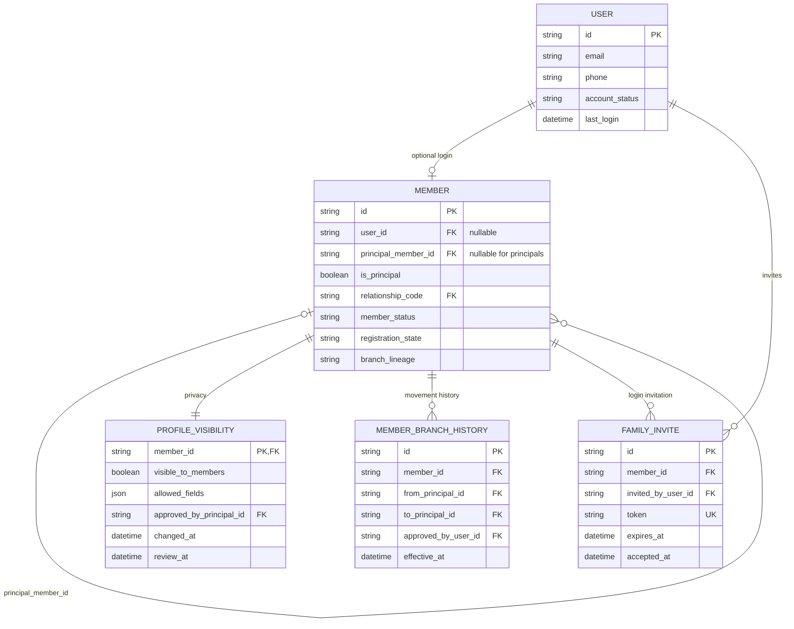
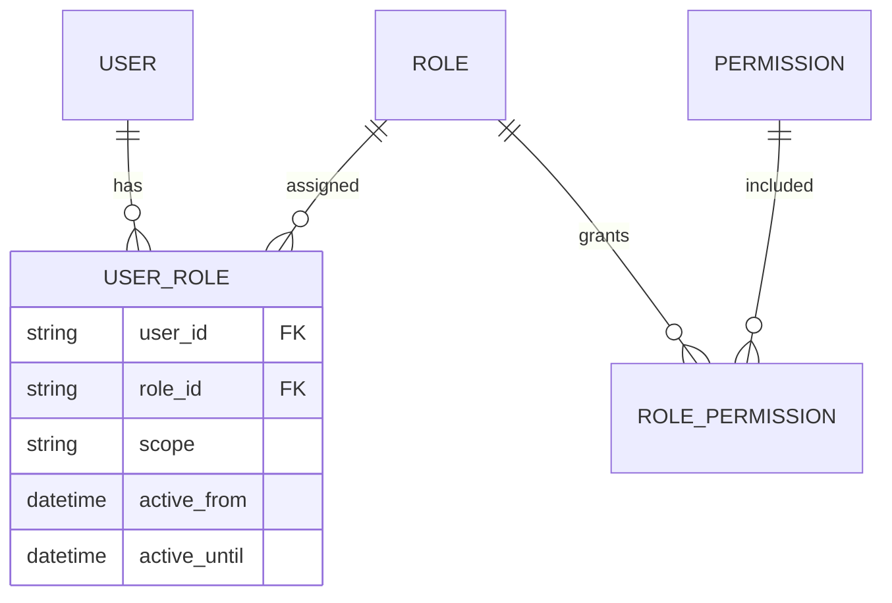
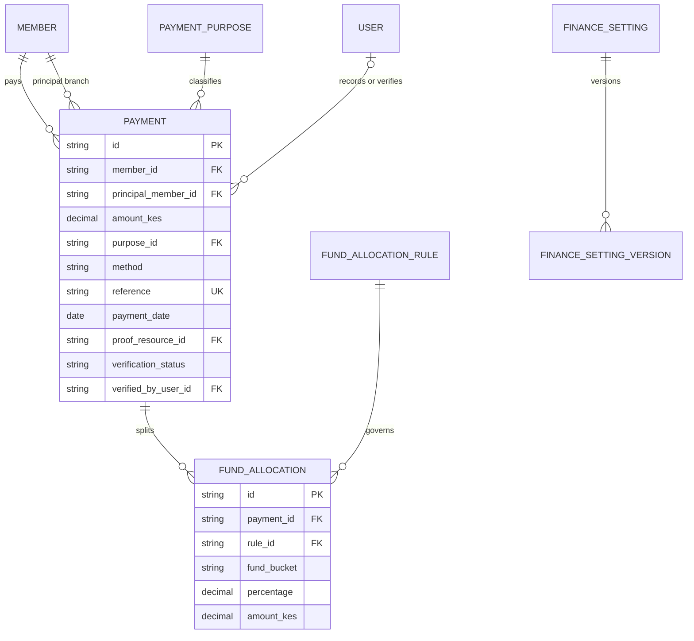
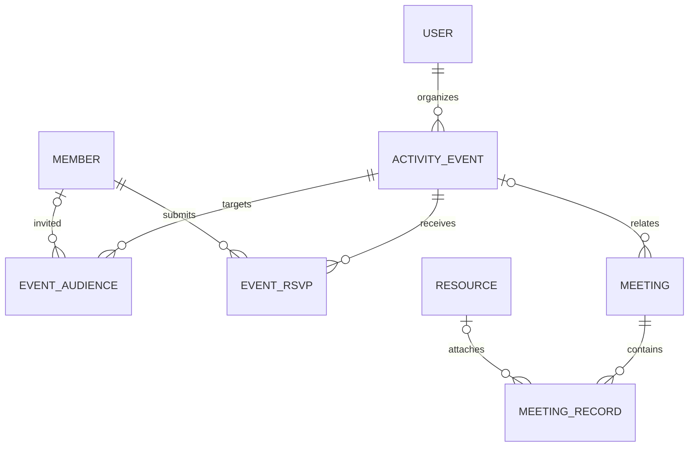
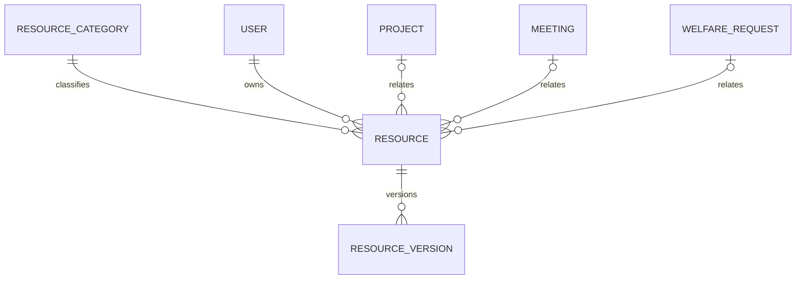
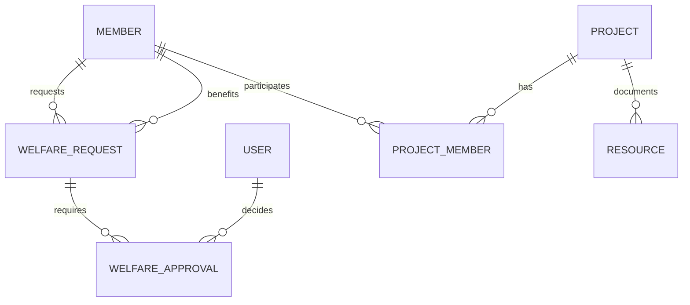
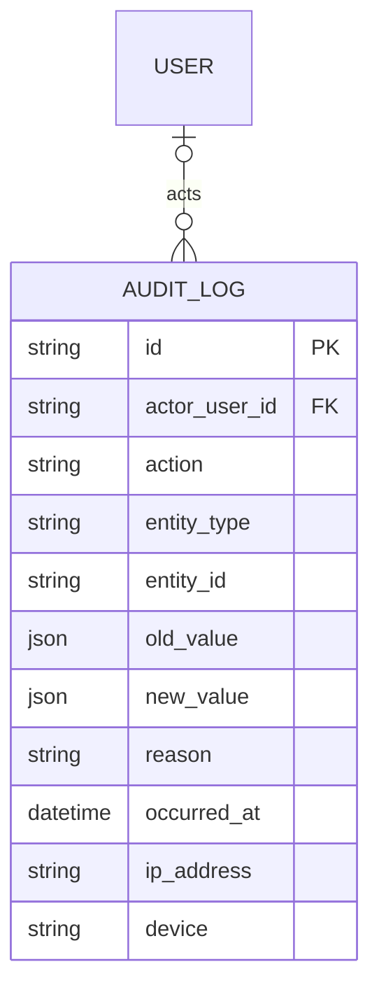

# Alubonets Target Data Model

**Purpose:** Define the target data structure required by the Website Upgrade Guide, including the family hierarchy, privacy, finance, activities, resources, welfare, projects and audit relationships.  
**Scope:** This is a logical target model. The live Prisma schema may use different physical names or split a logical object into several implementation tables.  
**Current implementation reference:** [`prisma/schema.prisma`](../prisma/schema.prisma)

## 1. Modelling principles

- A Principal Member is a member record with Principal status assigned only by an Administrator.
- Every attached member belongs to exactly one Principal Member at a time.
- A person and a login are separate concepts: children and other record-only members can exist without a user account.
- Attached-member profiles are hidden by default. Visibility is explicit, field-limited and auditable.
- Finance, welfare, governance and audit history is archived or statused rather than silently deleted.
- Payment purposes, account details, allocation rules, relationships and other governance values should be configurable.
- Role and visibility restrictions must be enforced by the backend, not only by the interface.

## 2. Whole-system ERD

```mermaid
erDiagram
    USER ||--o| MEMBER : "authenticates as"
    USER ||--o{ USER_ROLE : "is assigned"
    ROLE ||--o{ USER_ROLE : "grants"
    ROLE ||--o{ ROLE_PERMISSION : "contains"
    PERMISSION ||--o{ ROLE_PERMISSION : "is included in"

    MEMBER o|--o{ MEMBER : "Principal anchors attached members"
    MEMBER ||--o{ MEMBER_BRANCH_HISTORY : "has branch history"
    MEMBER ||--|| PROFILE_VISIBILITY : "has visibility policy"
    MEMBER ||--o{ FAMILY_INVITE : "receives invitation"
    USER ||--o{ FAMILY_INVITE : "sends invitation"

    MEMBER ||--o{ PAYMENT : "makes"
    MEMBER ||--o{ PAYMENT : "anchors branch report"
    PAYMENT_PURPOSE ||--o{ PAYMENT : "classifies"
    PAYMENT ||--o{ FUND_ALLOCATION : "is allocated"
    FUND_ALLOCATION_RULE ||--o{ FUND_ALLOCATION : "calculates"
    FINANCE_SETTING ||--o{ FINANCE_SETTING_VERSION : "has history"

    USER ||--o{ ACTIVITY_EVENT : "organizes"
    ACTIVITY_EVENT ||--o{ EVENT_AUDIENCE : "targets"
    MEMBER ||--o{ EVENT_AUDIENCE : "may be invited"
    ACTIVITY_EVENT ||--o{ EVENT_RSVP : "collects"
    MEMBER ||--o{ EVENT_RSVP : "responds"
    ACTIVITY_EVENT o|--o{ MEETING : "may contain"
    MEETING ||--o{ MEETING_RECORD : "produces"

    USER ||--o{ RESOURCE : "owns or uploads"
    RESOURCE_CATEGORY ||--o{ RESOURCE : "classifies"
    RESOURCE ||--o{ RESOURCE_VERSION : "has versions"
    PROJECT o|--o{ RESOURCE : "uses"
    MEETING o|--o{ RESOURCE : "uses"

    MEMBER ||--o{ WELFARE_REQUEST : "requests"
    MEMBER ||--o{ WELFARE_REQUEST : "may benefit"
    WELFARE_REQUEST ||--o{ WELFARE_APPROVAL : "requires"
    USER ||--o{ WELFARE_APPROVAL : "decides"

    PROJECT ||--o{ PROJECT_MEMBER : "has owners or team"
    MEMBER ||--o{ PROJECT_MEMBER : "participates"

    USER ||--o{ AUDIT_LOG : "performs action"
```

## 3. Membership and family ERD

### Membership tables

| Table | Important fields | Purpose and rules |
|---|---|---|
| `users` | `id`, `email`, `phone`, `auth_provider_id`, `account_status`, `last_login` | Authentication and account state. A record-only child or dependant does not require a row here. |
| `members` | `id`, nullable `user_id`, nullable `principal_member_id`, `is_principal`, `relationship_code`, names, DOB, contacts, lineage, `member_status`, `registration_state`, `registration_date` | Central person registry. Admin alone sets `is_principal`. Every attached member has one current Principal. |
| `relationship_types` | `code`, `label`, `active`, `sort_order` | Configurable relationship dropdown such as spouse, son, daughter, child, dependant or other. |
| `profile_visibility` | `member_id`, `visible_to_members`, `allowed_fields`, `approved_by_principal_id`, `changed_by`, `changed_at`, `review_at` | Field-level directory permission. Attached members default to hidden; child privacy rules can override permission. |
| `member_branch_history` | `member_id`, `from_principal_id`, `to_principal_id`, `approved_by_user_id`, `reason`, `effective_at` | Permanent, audited history for Admin-approved branch transfers and child-to-adult transitions. |
| `family_invites` | `member_id`, `email`, `token`, `invited_by_user_id`, `expires_at`, `accepted_at`, `revoked_at` | Activates a login for an existing attached person without creating a duplicate member. |

## 4. Roles and permissions ERD

### Access-control tables

| Table | Important fields | Purpose and rules |
|---|---|---|
| `roles` | `id`, `code`, `label`, `active` | Administrator, Member, Treasurer, Secretary, Organizer, Executive/Committee and optional Auditor roles. Principal is primarily a member status/capability, not a separate portal. |
| `permissions` | `id`, `code`, `description` | Atomic backend rights such as member approval, payment verification or document publication. |
| `user_roles` | `user_id`, `role_id`, `scope`, `active_from`, `active_until`, `assigned_by` | Assigns time-bound and optionally scoped roles. |
| `role_permissions` | `role_id`, `permission_id` | Many-to-many mapping used by backend authorization. |

## 5. Finance ERD

### Finance tables

| Table | Important fields | Purpose and rules |
|---|---|---|
| `payments` | `member_id`, derived `principal_member_id`, `amount_kes`, `purpose_id`, `method`, `reference`, `payment_date`, `proof_resource_id`, `verification_status`, `verified_by`, `verified_at` | Records money paid to the official group account. Positive amount and active purpose are required; verification changes are audited. |
| `payment_purposes` | `code`, `label`, `active`, `sort_order`, `accounting_category`, optional `fixed_amount`, optional `due_rule` | Admin/Treasurer-managed dropdown. Initial values cover registration, subscriptions, welfare/life events, medical, projects, education, community and other approved purposes. |
| `fund_allocation_rules` | `id`, `version`, `effective_from`, `effective_to`, `active`, `created_by` | Versions governance-approved splits, including the proposed 20% emergency and 80% reserve rule. |
| `fund_allocations` | `payment_id` or reporting period, `rule_id`, `fund_bucket`, `percentage`, `amount_kes` | Materialized allocation by payment or period; totals must equal the allocated amount. |
| `finance_settings` | `id`, `setting_key`, `active_version_id` | Points to the current official payment-destination configuration without hard-coding it across pages. |
| `finance_setting_versions` | `finance_setting_id`, account/paybill fields, `effective_from`, `changed_by`, `change_reason` | Immutable change history for official account details and other sensitive finance settings. |

## 6. Activities, events and meetings ERD

### Activity and meeting tables

| Table | Important fields | Purpose and rules |
|---|---|---|
| `activities_events` | `type`, `title`, start/end, `venue`, `organizer_user_id`, `description`, `status`, `is_public` | One calendar source for meetings, welfare events, family activities, training and project events. Today’s Activities queries private events for the current day. |
| `event_audiences` | `event_id`, audience type, nullable `branch_principal_id`, nullable `role_id`, nullable `member_id` | Supports public, all registered members, selected branch, committee/role or invited individuals. |
| `event_rsvps` | `event_id`, `member_id`, `response`, `responded_at`, attendance fields | RSVP and attendance without exposing one member’s private data to another. |
| `meetings` | `event_id`, `title`, `held_at`, `status`, `recorded_by` | Governance meeting linked to an event where applicable. |
| `meeting_records` | `meeting_id`, `record_type`, text/body, `resource_id`, `version`, `approved_at` | Agenda, minutes, attendance, resolutions and action items, with publish/version history. |

## 7. Resources and documents ERD

### Resource tables

| Table | Important fields | Purpose and rules |
|---|---|---|
| `resources` | `title`, `category_id`, `description`, `owner_user_id`, `visibility`, related entity type/id, `retention_status`, `archive_status` | Searchable metadata record for governance, meetings, finance, projects, welfare, education/health and historical archives. |
| `resource_versions` | `resource_id`, `version`, storage key, file name/type/size, checksum, `uploaded_by`, `uploaded_at` | Preserves important versions rather than overwriting files. Storage access remains private unless explicitly public. |
| `resource_categories` | `id`, `code`, `label`, nullable `parent_id`, `active`, `sort_order` | Folder/category hierarchy with configurable governance and program areas. |
| `resource_tags` / `resource_tag_links` | tag name; `resource_id`, `tag_id` | Optional many-to-many tags for discovery and filtering. |
| `resource_access_logs` | `resource_id`, `version_id`, `user_id`, action, timestamp, IP/device | Audits upload, replacement, sensitive download, archive and deletion attempts. |

## 8. Welfare and projects ERD

### Welfare and project tables

| Table | Important fields | Purpose and rules |
|---|---|---|
| `welfare_requests` | `requester_member_id`, `beneficiary_member_id`, `category_id`, amount/support, `status`, `confidentiality_level`, dates | Tracks private welfare assistance for a member or attached family beneficiary. |
| `welfare_approvals` | `request_id`, `approver_user_id`, approver role/step, decision, reason, timestamp | Optional configurable multi-step approval history. |
| `projects` | name, description, status, budget summary, dates, owner/team, visibility | Tracks approved investment, education, health and community initiatives. |
| `project_members` | `project_id`, `member_id`, responsibility, active dates | Many-to-many project ownership and participation. |

## 9. Audit and history ERD

### Audit table

| Table | Important fields | Purpose and rules |
|---|---|---|
| `audit_logs` | `actor_user_id`, action, entity type/id, old/new summaries, reason, timestamp, IP/device | Append-only evidence for member/branch changes, roles, profile visibility, finance actions, exports and resource administration. Audit rows remain when the referenced business record is archived. |

## 10. Relationship rules

| Relationship | Cardinality | Required rule |
|---|---|---|
| User to Member | One to zero-or-one | A login may represent one member; a member may exist without a login. `members.user_id` is unique when present. |
| Principal Member to Attached Member | One to many | An attached member resolves to exactly one active Principal; a Principal’s own `principal_member_id` is null. Cycles and self-links are forbidden. |
| Member to Profile Visibility | One to one | Every member receives a default policy; attached members and children start hidden. |
| Member to Branch History | One to many | Every transfer or linkage change is retained with Admin approval and reason. |
| Member to Payment | One to many | A payment has one paying member and a derived Principal branch for reporting. |
| Payment Purpose to Payment | One to many | Every payment uses one active purpose; historical payments keep their original purpose reference. |
| Payment to Fund Allocation | One to many | Allocation rows use one effective rule version and must reconcile to the allocated total. |
| Event to Audience | One to many | At least one audience rule is required for private events; public events never expose member-only attachments. |
| Event to Meeting | One to zero-or-many | A meeting may be linked to a calendar event; ordinary activities need no meeting. |
| Resource to Version | One to many | Published important documents keep immutable versions and a current-version pointer. |
| Welfare Request to Approval | One to many | Approval count and roles are configurable; all decisions remain auditable. |
| Project to Member | Many to many | The join row records responsibility and active dates. |
| User to Audit Log | One to many | Actor deletion never removes the audit entry; the actor FK may become null while its snapshot remains. |

## 11. Delete and retention behaviour

| Data group | Delete behaviour | Reason |
|---|---|---|
| Members and family history | Archive/status change; restrict hard delete when referenced | Preserves lineage, finance, welfare and governance history. |
| Payments, allocations and finance-setting versions | No ordinary hard delete; reverse/correct with reason | Maintains financial accountability. |
| Resources | Archive metadata; retain governed versions according to policy | Prevents silent loss or overwrite of official records. |
| Audit logs | Append-only and retained under an approved policy | Preserves evidence of sensitive actions. |
| Invitations, sessions and temporary security records | Expire and purge under a defined retention policy | Limits unnecessary personal/security data retention. |

## 12. Guide-to-current-schema mapping

The target model above should be reconciled with the existing Prisma implementation rather than recreated blindly.

| Guide concept | Current implementation direction | Remaining alignment |
|---|---|---|
| `users` + `members` | The current `User` model carries authentication-linked membership fields, while `MemberProfile` stores extended profile data. | Decide whether to keep the combined structure or later separate record-only people more fully; preserve a nullable-login design. |
| Principal branch | `User.isPrincipal`, `User.principalMemberId`, `User.familyRelationship`, `User.familyRegistrationState`, `FamilyInvite` and `FamilyBranchHistory` are implemented. The migration, self-link/branch-shape constraints, Admin transfer workflow and history backfill are deployed. | Profile-visibility rules remain a separate P2 feature. |
| Roles/permissions | Current role enum and dashboard-access fields provide role control. | Add a normalized permission matrix only if the current authorization design cannot express required scopes and active dates. |
| Payments and purposes | `Contribution` (with `contributionPeriod`, campaign/project links) and an immutable double-entry ledger (`FinancialTransaction`, `LedgerEntry`, protected by database triggers). Purposes are `TransactionCategory` rows with a billing kind (Monthly Contribution, Annual Contribution, campaigns, projects, Other). Official account versioning and fund-allocation rules (`FundAllocationRule`, snapshotted on each payment) are implemented. Every confirmed contribution has a ledger transaction. | Branch-level reporting polish. |
| Membership standing | `User.standing`, override fields and `User.contributionPlan` (`MONTHLY` / `ANNUAL`) drive automatic Paid-up / Lapsed standing from monthly and annual dues. | Assign plans to existing members. |
| Notifications | `UserNotification.audienceRoles` and `Announcement.audienceRoles` make notices role-specific per workspace. | — |
| Activities/events | `Event`, invitation, RSVP, attendance, attachment and cost models exist. | Add Today’s Activities behavior and stronger branch/meeting linkage. |
| Resources | `Document`, category/download data and project-document models exist. | Align resource metadata, tags, related entities, retention and sensitive access logging. |
| Welfare/projects | Welfare has confidentiality, Treasurer + Executive approvals and decision history; projects have dates, funding progress and linked expenses. | Family beneficiaries if required. |
| Audit | `AuditLog` stores actor, acting role, entity, old/new values, reason and request context; finance corrections, plans, family transfers, About-page changes and report downloads are audited. | Keep adding entries for new actions. |

## 13. Data-model acceptance checks

- Admin is the only actor allowed to assign or remove Principal status.
- A non-principal cannot create or attach family records.
- No member can point to themselves, form a family cycle or have two active Principals.
- Record-only children and dependants do not receive login credentials automatically.
- Converting a record-only person to a login reuses the same member identity.
- Attached profiles remain hidden until an allowed Principal action and child/privacy policy both permit visibility.
- Every payment has one active purpose, a positive KES amount and an auditable verification state.
- Official account settings and allocation rules retain immutable version history.
- Resources retain governed versions and enforce visibility on every download.
- All branch transfers, visibility changes, finance actions and resource administration are audited.
