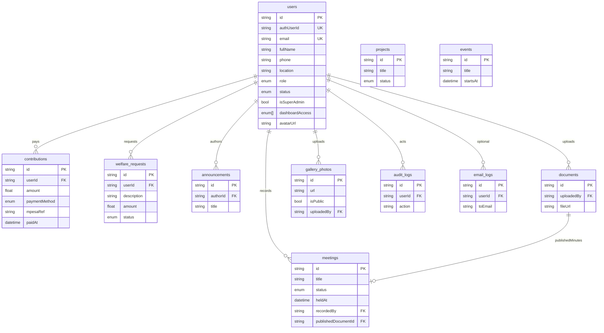

# Alubonets data model

What the group’s app stores in Postgres: tables, columns, relationships, and how Auth links in.

**Source of truth:** [`prisma/schema.prisma`](../prisma/schema.prisma)  
**Postgres (Supabase)** · table names use `@@map` (e.g. `users`, `contributions`).  
**ORM:** Prisma · **Auth identities:** Supabase Auth (`auth.users`) linked via `users.authUserId`.

App writes mostly go through Prisma (service connection; bypasses RLS). Browser Supabase clients are RLS-scoped — see [`supabase/policies.sql`](../supabase/policies.sql).

**How features use this data** (receipts, payments, dashboards): root [README](../README.md).  
**How to connect and seed:** [BACKEND_SETUP.md](./BACKEND_SETUP.md).

---

## ERD (entity relationships)

---

## Enums

| Enum | Values | Used by |
|------|--------|---------|
| `Role` | `ADMIN`, `EXECUTIVE`, `TREASURER`, `SECRETARY`, `ORGANIZER`, `MEMBER` | `users.role`, `users.dashboardAccess[]` |
| `MemberStatus` | `PENDING`, `ACTIVE`, `INACTIVE`, `SUSPENDED` | `users.status` |
| `ProjectStatus` | `UPCOMING`, `ONGOING`, `COMPLETED` | `projects.status` |
| `WelfareStatus` | `PENDING`, `APPROVED`, `REJECTED`, `PAID` | `welfare_requests.status` |
| `PaymentMethod` | `CASH`, `MPESA`, `BANK`, `OTHER` | `contributions.paymentMethod` |
| `MeetingStatus` | `DRAFT`, `FINAL` | `meetings.status` |

---

## Tables

### `users` (model `User`)

Member and staff profiles. One row per person. Linked to Supabase Auth when `authUserId` is set.

| Column | Type | Notes |
|--------|------|--------|
| `id` | String (cuid) | Primary key (app id, not Auth uuid) |
| `authUserId` | String? unique | Supabase `auth.users.id` |
| `email` | String unique | Login / contact |
| `fullName` | String | Display name |
| `phone` | String? | Optional |
| `location` | String? | Profile location (e.g. Nairobi, Kenya) |
| `role` | Role | **Primary** home dashboard |
| `status` | MemberStatus | Gate for login / middleware |
| `isSuperAdmin` | Boolean | Hierarchy; only supers grant Admin / supers |
| `dashboardAccess` | Role[] | Extra workspaces beyond primary role |
| `avatarUrl` | String? | Profile image URL |
| `createdAt` / `updatedAt` | DateTime | |

**Relations:** owns contributions, welfare requests, audit/email logs; authors announcements; uploads documents & gallery; records meetings.

**JWT sync:** On role/status/access changes, `app_metadata` is updated to `{ role, status, isSuperAdmin, dashboardAccess }` for Edge middleware.

---

### `contributions` (model `Contribution`)

Money received from a member (cash, bank, M-Pesa, etc.).

| Column | Type | Notes |
|--------|------|--------|
| `id` | String | PK |
| `userId` | String FK → users | Cascade delete |
| `amount` | Float | Must be &gt; 0 (DB check in policies.sql) |
| `description` | String? | |
| `category` | String? | e.g. monthly dues |
| `paymentMethod` | PaymentMethod | Default `CASH` |
| `receivedBy` | String? | Who recorded it |
| `statementRef` | String? | Bank / statement ref |
| `paidAt` | DateTime | Payment date |
| `mpesaRef` | String? | M-Pesa receipt / checkout ref |
| `createdAt` | DateTime | Row created |

**Indexes:** `userId`, `paidAt`.

**Flows:** Treasurer form / CSV import / M-Pesa callback → row → PDF receipt `/api/pdf/receipt/[id]`.

---

### `welfare_requests` (model `WelfareRequest`)

Member asks for welfare support; treasurer reviews.

| Column | Type | Notes |
|--------|------|--------|
| `id` | String | PK |
| `userId` | String FK → users | Cascade |
| `description` | String | Need |
| `amount` | Float? | Optional ask |
| `status` | WelfareStatus | Default `PENDING` |
| `reviewNote` | String? | Staff note |
| `createdAt` / `updatedAt` | DateTime | |

---

### `projects` (model `Project`)

Group projects shown on public + executive/organizer/member dashboards.

| Column | Type | Notes |
|--------|------|--------|
| `id` | String | PK |
| `title` / `description` | String | |
| `status` | ProjectStatus | |
| `imageUrl` | String? | |
| `progress` | Int | 0–100 |
| `startDate` / `endDate` | DateTime? | |
| `budgetKes` / `fundingTargetKes` / `actualExpenditureKes` | Decimal(14,2) | Manager-only detail on public |
| `createdAt` / `updatedAt` | DateTime | |

Related: `project_comments`, `project_investments` (pledge records, not ledger posts), `project_milestones`, `project_updates`, `project_responsibles`, `project_documents`. Optional `expenses.projectId`.

---

### `gallery_photos` (model `GalleryPhoto`)

| Column | Type | Notes |
|--------|------|--------|
| `id` | String | PK |
| `url` | String | Image URL (or Storage public URL) |
| `caption` / `category` | String? | |
| `isPublic` | Boolean | `false` = approval queue |
| `approvedAt` | DateTime? | Set when published |
| `uploadedBy` | String? FK → users | SetNull on user delete |
| `uploadedAt` | DateTime | |

Public gallery only shows `isPublic = true`. Admin queue: `/admin/gallery-queue`.

---

### `announcements` (model `Announcement`)

| Column | Type | Notes |
|--------|------|--------|
| `id` | String | PK |
| `title` / `content` | String | |
| `authorId` | String FK → users | Cascade |
| `broadcast` | Boolean | true = all active members |
| `status` | AnnouncementPublishStatus | `DRAFT` \| `SCHEDULED` \| `SENT` |
| `scheduledFor` | DateTime? | Cron sends when due |
| `audienceRoles` | Role[] | Optional role targeting |
| `familyBranch` | String? | Optional branch targeting |
| `templateKey` | String? | FK-like to AnnouncementTemplate.key |
| `mandatory` | Boolean | Ignores email opt-out |
| `emailSentAt` / `publishedAt` / `createdAt` | DateTime | |

### `announcement_receipts` (model `AnnouncementReceipt`)

| Column | Type | Notes |
|--------|------|--------|
| `announcementId` / `userId` | String | Unique pair |
| `readAt` | DateTime? | Dashboard read |
| `emailStatus` | AnnouncementDeliveryStatus | PENDING\|SENT\|FAILED\|SKIPPED |
| `emailError` / `emailSentAt` / `retryCount` | | Email delivery trace |

### `announcement_templates` / `user_notification_preferences`

Admin-managed HTML templates; members can set `emailOptional` (mandatory notices always send).

Realtime: clients can subscribe (member home).

---

### `events` (model `Event`)

| Column | Type | Notes |
|--------|------|--------|
| `id` | String | PK |
| `title` | String | |
| `description` / `location` / `imageUrl` | String? | |
| `startsAt` / `endsAt` | DateTime | endsAt optional |
| `isPublic` | Boolean | Public site listing |
| `audienceType` | EventAudienceType | PUBLIC\|ALL_MEMBERS\|SELECTED_ROLES\|SELECTED_MEMBERS |
| `audienceRoles` | Role[] | When SELECTED_ROLES |
| `capacity` / `rsvpDeadlineAt` | | Optional RSVP limits |
| `budgetKes` / `actualCostKes` | Decimal | Event money (no auto ledger) |
| `reminderOffsetsHours` | Int[] | e.g. 24, 2 |
| `remindersSent` | Json? | Offset → sentAt tracking |
| `reportBody` / `reportPublishedAt` | | Post-event report |
| `galleryPhotoIds` | String[] | Optional gallery refs |
| `createdAt` / `updatedAt` | DateTime | |

Related: `EventInvitation`, `EventRSVP` (GOING\|MAYBE\|NOT_GOING), `EventAttendance`, `EventAttachment`, `EventCost`. Optional `Expense.eventId` for manual finance link.

---

### `documents` (model `Document`)

| Column | Type | Notes |
|--------|------|--------|
| `id` | String | PK |
| `title` | String | |
| `fileUrl` | String | URL or Storage path |
| `category` | String? | |
| `uploadedBy` | String FK → users | Cascade |
| `uploadedAt` | DateTime | |

### `app_settings` (model `AppSetting`)

Key/value configuration (no secrets). Typed helpers in `lib/settings.ts`.

### `feature_flags` (model `FeatureFlag`)

| Column | Type | Notes |
|--------|------|--------|
| `key` | String | PK e.g. `loans_enabled` |
| `enabled` | Boolean | Default false |

### Category master data

`WelfareCategory`, `ProjectCategory`, `MembershipClass` (id, name, active, sortOrder). Contribution categories continue to use `TransactionCategory`.

### Loans (Stage 7)

`LoanApplication` — applicant, amountKes, purpose, dueAt?, status (SUBMITTED→…→DISBURSED/CLOSED), treasurer/admin decision fields.

`LoanGuarantor` — loanId, userId, PENDING|ACCEPTED|DECLINED.

`LoanLedgerLink` — loanId, transactionId, DISBURSEMENT|REPAYMENT. Outstanding = sum(confirmed disbursements) − sum(confirmed repayments).

---

Private Storage bucket `documents` (see `storage.sql`); signed URLs for downloads.

---

### `meetings` (model `Meeting`)

Structured minutes live here as **text** (source of truth). PDFs are generated on demand from this row; an optional published PDF is stored in the `documents` bucket.

| Column | Type | Notes |
|--------|------|--------|
| `id` | String | PK |
| `title` | String | |
| `opening` | String? | Call to order / opening notes |
| `agenda` | String? | |
| `minutes` | String? | Discussion body |
| `attendees` | String? | Names list |
| `resolutions` | String? | Decisions |
| `location` | String? | Venue |
| `nextMeetingAt` | DateTime? | |
| `status` | MeetingStatus | `DRAFT` (editable) or `FINAL` (published) |
| `heldAt` | DateTime | Meeting datetime |
| `attendance` | Int | Headcount (default 0) |
| `recordedBy` | String FK → users | Secretary / admin |
| `publishedDocumentId` | String? unique FK → documents | Official PDF library entry |
| `createdAt` / `updatedAt` | DateTime | |

**Flows:**

1. Secretary edits at `/dashboard/secretary/meetings/[id]` (letterhead preview).
2. **Download PDF** anytime → `GET /api/pdf/minutes/[id]` (pdf-lib from current DB text; not stored).
3. **Mark final & publish** → upload `minutes/{id}.pdf` to Storage bucket `documents` → create/update `documents` row (`category: Minutes`) → set `status = FINAL`.
4. Bulk DOCX still: `/api/export/meetings`.

Members may download PDF only when `status = FINAL`. Staff (Secretary / Admin / Executive) may download drafts.

---

### `email_logs` (model `EmailLog`)

| Column | Type | Notes |
|--------|------|--------|
| `id` | String | PK |
| `userId` | String? FK | Optional member link |
| `toEmail` / `subject` | String | |
| `template` | String? | Template key |
| `status` | String | e.g. `sent` |
| `meta` | Json? | Provider ids, etc. |
| `createdAt` | DateTime | |

---

### `audit_logs` (model `AuditLog`)

| Column | Type | Notes |
|--------|------|--------|
| `id` | String | PK |
| `userId` | String? FK | Actor (`ON DELETE SET NULL` — logs retained if user removed) |
| `action` | String | e.g. `MEMBER_APPROVE`, `DOCUMENT_REPLACE` |
| `entity` / `entityId` | String? | Target |
| `meta` | Json? | Extra payload |
| `oldValue` / `newValue` | Json? | Snapshots for sensitive updates |
| `reason` | String? | Required for many status/finance changes |
| `ipAddress` / `userAgent` | String? | Client context where captured |
| `createdAt` | DateTime | |

Append-only: app deletes are blocked by a DB trigger unless `app.allow_audit_purge=on` (retention cron/script only).

---

### `app_settings` / `feature_flags` (Stage 8)

`AppSetting`: key/value (typed in `lib/settings.ts`; no secrets).  
`FeatureFlag`: key + enabled (e.g. `loans_enabled`).

Master categories: `WelfareCategory`, `ProjectCategory`, `MembershipClass`. Contribution categories use existing `TransactionCategory`.

### Loans (Stage 7)

| Model | Notes |
|-------|--------|
| `LoanApplication` | amountKes, purpose, status, treasurer/admin decision fields |
| `LoanGuarantor` | PENDING \| ACCEPTED \| DECLINED |
| `LoanLedgerLink` | DISBURSEMENT \| REPAYMENT → `FinancialTransaction`; outstanding = disbursed − repaid |

---

## Auth vs app data

| Store | What lives there |
|-------|------------------|
| **Supabase Auth** | Email/password or Google identity, session cookies, `app_metadata` claims |
| **`users` table** | Role, status, profile fields, dashboard grants, business FKs |
| **Storage buckets** | `gallery` (public read), `documents` (private) — not Prisma tables |

Linking: register / OAuth / bootstrap sets `users.authUserId = auth.users.id`.

---

## Seeded dev accounts

> **Dev / local only.** Do not use these passwords in production. Change them before any shared environment.  
> Created by: `npm run db:seed` + `npm run db:bootstrap-auth`.  
> Override non-super password with env `SEED_AUTH_PASSWORD` before bootstrap if needed.

| Email | Password | Role | Status | Sign in | Lands on |
|-------|----------|------|--------|---------|----------|
| `superadmin@alubonets.com` | `SuperAdmin@2026!` | ADMIN (Super Admin) | ACTIVE | `/admin/login` | `/admin` |
| `admin@alubonets.com` | `ChangeMe123!` | ADMIN | ACTIVE | `/admin/login` | `/admin` |
| `executive@alubonets.com` | `ChangeMe123!` | EXECUTIVE | ACTIVE | `/login` | `/dashboard/executive` |
| `treasurer@alubonets.com` | `ChangeMe123!` | TREASURER | ACTIVE | `/login` | `/dashboard/treasurer` |
| `secretary@alubonets.com` | `ChangeMe123!` | SECRETARY | ACTIVE | `/login` | `/dashboard/secretary` |
| `organizer@alubonets.com` | `ChangeMe123!` | ORGANIZER | ACTIVE | `/login` | `/dashboard/organizer` |
| `member@alubonets.com` | `ChangeMe123!` | MEMBER | ACTIVE | `/login` | `/dashboard/member` |
| `pending@alubonets.com` | `ChangeMe123!` | MEMBER | PENDING | `/login` | `/pending` |

Also after login: shared profile at `/profile`. Super Admin can switch workspaces from the dashboard header.

Seed also creates sample contributions, projects, announcements, etc. (see `prisma/seed.ts`).

---

## Changing the schema

1. Edit `prisma/schema.prisma`  
2. `npm run db:push` (or `db:migrate`)  
3. `npm run db:generate`  
4. If RLS column names change, update `supabase/policies.sql` and re-run  
5. Update this file + seed if needed  
